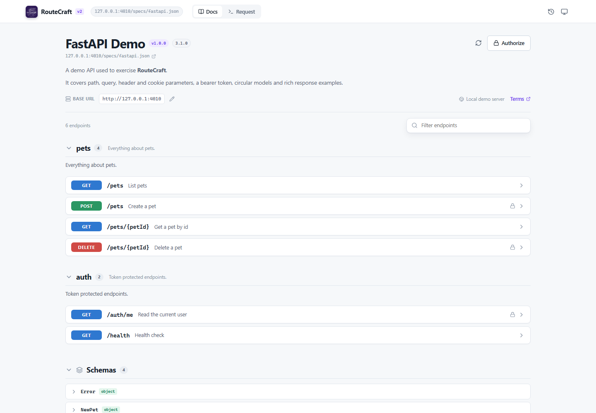
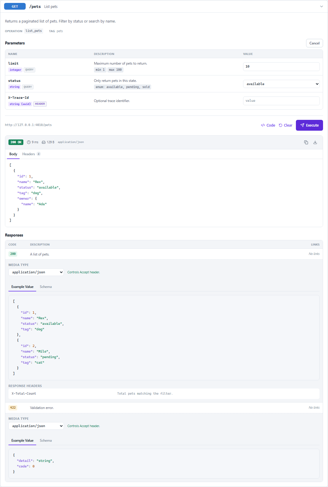
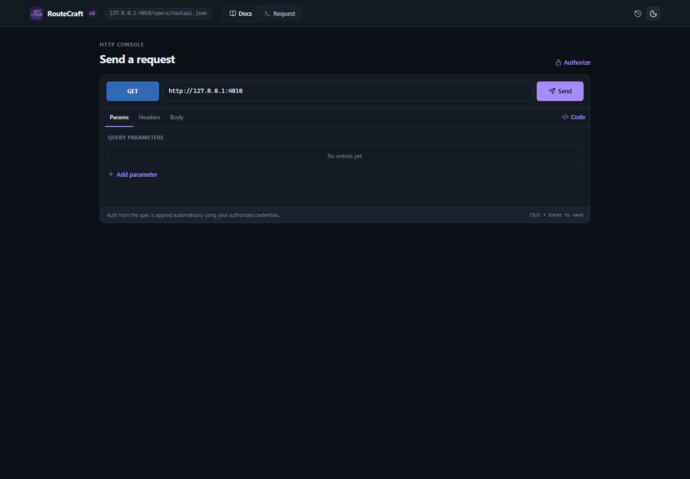
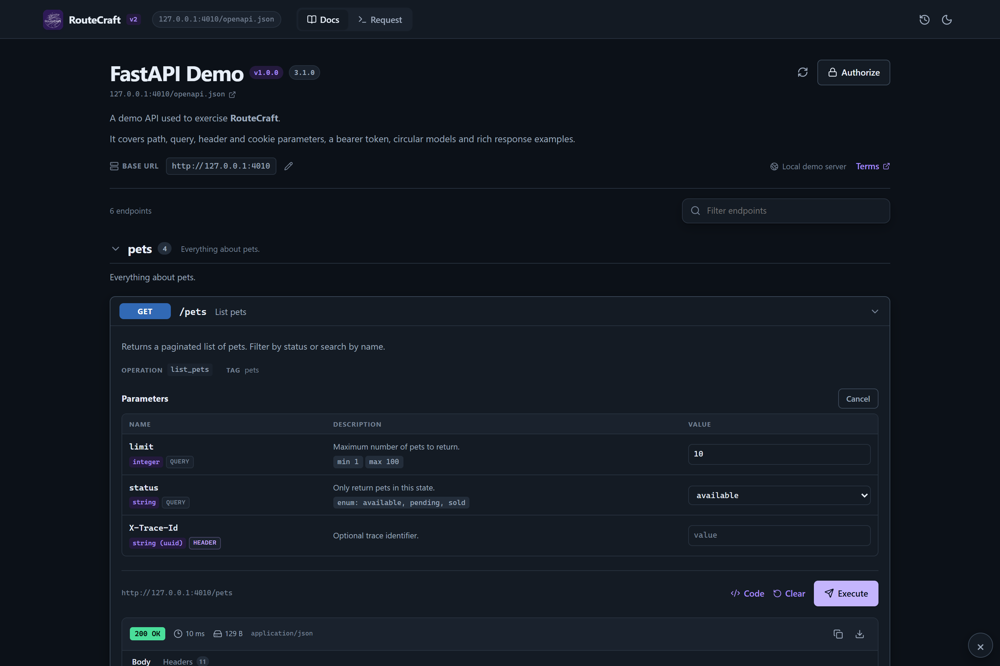

# RouteCraft

**Read the docs. Send the request.** A clean Swagger UI / FastAPI-style explorer for any OpenAPI document, with a full API console built into the same page.

> **Published on GitHub Pages:** <https://anikethana21.github.io/routecraft/>
>
> [**Install the userscript**](https://anikethana21.github.io/routecraft/routecraft.user.js) — free, no store account or payment card. Current version: **2.3.1**.

RouteCraft is a drop-in replacement for the documentation *and* the request runner. Load an OpenAPI 2.0, 3.0 or 3.1 document, browse it like Swagger UI, then execute endpoints inline — with no page switching and no login. The Tampermonkey userscript adds a zero-CORS transport for localhost and APIs that do not send CORS headers. The same app is also hosted on GitHub Pages, and the optional Chrome extension adds a toolbar popup and address-bar launcher.



## Why it exists

Swagger UI is excellent at reading docs. Postman is excellent at sending requests. RouteCraft does both in one quiet interface:

- The docs page stays close to Swagger UI / `/docs`: tags, method-tinted endpoint cards, parameters, schemas and responses.
- **Try it out** works like Swagger UI: enable an operation, fill its inputs, then **Execute**. The request lives inside the endpoint that it calls, so there is no separate collection to configure first.
- The **Request** tab is a free-form HTTP console for anything not in the spec.
- The **Chrome extension** proxies requests through a Manifest V3 service worker, so requests are not blocked by CORS.

## Features

### Specifications
- OpenAPI **3.1**, **3.0** and Swagger **2.0** (converted to the same internal model).
- JSON and YAML, loaded from a URL, dragged/dropped file, file picker or pasted text.
- Recursive `$ref` resolution, circular schemas, `allOf` / `oneOf` / `anyOf`, examples, defaults and enums.
- Relative server URLs and server variables.
- Schema browser with nested model expansion.

### Documentation
- Tag sections, endpoint descriptions, operation metadata and Markdown.
- Endpoint filter across paths, summaries, descriptions, operation IDs and methods.
- Swagger UI-style **Try it out** / **Execute** / **Clear** flow, with `Cancel` to leave edit mode.
- Parameter table for path, query, header and cookie parameters.
- Request-body editor with content-type switching, schema view, format and reset-to-example.
- Response table with Code, Description and Links columns.
- Response media-type selector plus **Example Value** and **Schema** tabs for every declared status.
- Server/base-URL switcher and editable base URL.

### Request execution
- Execute any documented operation inline after clicking **Try it out**, or use the free-form Request console.
- Path, query, header and cookie parameters.
- JSON, `application/x-www-form-urlencoded`, `multipart/form-data` (text fields) and plain-text bodies.
- Auth: HTTP Bearer, HTTP Basic, API key (header/query/cookie), OAuth 2.0 token exchange and OpenID Connect tokens.
- OAuth token exchange also uses the zero-CORS transport.
- Response status, latency, size, content type, body viewer, headers, copy and download.
- Required parameter validation and client-side JSON validation before sending.
- Request history with date grouping, replay, delete, clear and JSON export.
- Code generation in 11 targets: cURL, JavaScript `fetch`, Axios, Python, Go, PHP, Ruby, Java, C#, HTTPie and PowerShell.
- Light/dark/system themes, responsive layout and `Ctrl/Cmd + Enter` to send.
- Local persistence for theme, recent specs, composer drafts, credentials and history.

### Browser surfaces
- **Chrome extension:** a toolbar popup with one-click launch, current-tab detection and a port/spec quick-open field. The full-tab app uses a Manifest V3 service worker for zero-CORS API traffic and spec loading. An `rc` address-bar keyword opens a spec directly. Optional side-panel build target.
- **Tampermonkey userscript (free, no-account path):** injects the same app into a shadow root on any page. `GM_xmlhttpRequest` provides the zero-CORS transport, and specs are auto-detected on Swagger UI / FastAPI `/docs` pages. Install directly from GitHub Pages; no store review, developer account or payment card is needed.
- **Hosted web app:** the production build is published at <https://anikethana21.github.io/routecraft/app/>. It is useful for browsing public specs without installing anything, but requests still follow the API's CORS policy unless the userscript or extension is active.
- **MCP for AI agents:** a local server opens a normal browser tab with RouteCraft, deep-links an operation, and injects the same zero-CORS bridge. No extension or userscript is needed in this mode.
- No remote code, analytics or external service. Requests go only to the URL you choose.

## Screenshots

| Run an endpoint | Request console |
| --- | --- |
|  |  |

More in [`screenshots/`](screenshots/) and ready-to-upload Chrome Web Store assets in [`store-assets/`](store-assets/).

## Quick start

```bash
npm install
npm run dev
```

Open the URL printed by Vite (normally `http://127.0.0.1:5173`) and enter a spec URL such as `http://127.0.0.1:8000/openapi.json`.

### Free userscript path (quickest test)

This is the install path that does not need a Chrome Web Store developer account or a payment card.

1. Install [Tampermonkey](https://www.tampermonkey.net/).
2. Open the GitHub Pages install URL and click **Install**:

   <https://anikethana21.github.io/routecraft/routecraft.user.js>

3. Start the demo APIs you need below. The authenticated To-Do demo is the best end-to-end test.
4. Open <http://127.0.0.1:8012/docs>, <http://127.0.0.1:8010/docs>, <http://127.0.0.1:8011/docs> or <http://127.0.0.1:8013/docs> (or the `/rc` shortcut on any demo), then click the floating **RouteCraft** button or press **Alt+Shift+S**. The spec is detected automatically.
5. In the To-Do demo, click **Authorize**, use the password flow with `demo` / `demo123`, and try the full CRUD list. For the status demos, try `GET /status/{code}` with `418` or `GET /items`.

The userscript is self-contained: the React app, styles and OpenAPI engine are inside `routecraft.user.js`. It does not need the extension, a hosted backend or a store listing.

Raw GitHub mirror, if you prefer it:

<https://raw.githubusercontent.com/anikethana21/routecraft/main/routecraft.user.js>

### GitHub Pages

GitHub Pages is the primary published distribution:

| Surface | URL |
| --- | --- |
| Landing and install page | <https://anikethana21.github.io/routecraft/> |
| Userscript | <https://anikethana21.github.io/routecraft/routecraft.user.js> |
| Hosted web app | <https://anikethana21.github.io/routecraft/app/> |
| Icon | <https://anikethana21.github.io/routecraft/icon128.png> |

The site is generated into `docs/` from the landing page in `site/`, the production build in `dist/` and `routecraft.user.js`:

```bash
npm run pages:build
```

Commit the regenerated `docs/` folder and push. GitHub Pages serves `main` → `/docs`; no Actions workflow, store account or payment card is required. The `docs/` folder is generated — do not edit it by hand.

### Production build

```bash
npm run build
npm run preview
```

The web build is in `dist/`. The same folder is also a loadable Chrome extension.

## Install the Chrome extension (optional)

The extension adds the toolbar popup, current-tab detection and the `rc` address-bar shortcut. The userscript above is the free no-store path; the Chrome Web Store version is optional and requires a developer account for publishing.

### Load unpacked (development)

1. Run `npm run build`.
2. Open `chrome://extensions/`.
3. Enable **Developer mode**.
4. Click **Load unpacked** and select the `dist` folder.
5. Pin **RouteCraft** and click its toolbar icon. The popup opens with **Open RouteCraft**, an **Open this API** button when the current tab is a web page, and a port/spec quick-open field.

### Launch shortcuts

- **Toolbar popup:** click the icon, then **Open RouteCraft** for a new/focused app tab, or **Open this API** to use the current tab's origin.
- **Address bar:** type `rc`, press **Space** or **Tab**, then enter a port, host or spec URL.

  ```text
  os 8010
  os localhost:8010
  os https://petstore3.swagger.io/api/v3/openapi.json
  ```

- **Protected specs:** add `-H "Name: Value"` to the address-bar or popup input. The MV3 service worker fetches the spec with that header, so CORS does not block it.

  ```text
  os 8010 -H "Authorization: Bearer demo-token"
  ```

  The header is kept only in `chrome.storage.session` for two minutes and is not written to disk. Prefer the popup for long-lived secrets because address-bar input may remain in Chrome's omnibox history.

The quick-open field accepts the same syntax as the address bar. A bare port such as `8010` is treated as `http://127.0.0.1:8010`; the app then tries the usual `/openapi.json`, `/swagger.json`, `/v3/api-docs` and framework docs locations.

### Package for the Chrome Web Store

```bash
npm run package:extension
```

This writes `routecraft-extension.zip` (manifest at the archive root) and `dist/` for local testing. Upload the zip in the Chrome Web Store developer dashboard. See [`STORE_LISTING.md`](STORE_LISTING.md) for listing copy, permission justifications and asset sizes, and [`PRIVACY.md`](PRIVACY.md) for the privacy policy.

### Store assets

```bash
npm run store:assets
```

The five 1280×800 screenshots are generated by the Playwright suite. The 440×280 promo tile and 1400×560 marquee are generated by the script above.

## Install the Tampermonkey userscript

The userscript is a single self-contained file: the React app, styles and OpenAPI engine are all inside it. It does not need the extension or a hosted web app.

GitHub Pages is the published userscript distribution. The `@updateURL` and `@downloadURL` headers point at the Pages copy, so Tampermonkey updates it in place after each Pages build. The raw GitHub file remains available as a mirror. No store account, review or payment card is involved.



1. Install [Tampermonkey](https://www.tampermonkey.net/) in Chrome, Edge, Firefox or Safari.
2. Open the install URL:

   <https://anikethana21.github.io/routecraft/routecraft.user.js>

3. Tampermonkey shows the install screen. Click **Install**.
4. Open an API docs page, or any page where you want to test an API. Click the floating **RouteCraft** button in the bottom-right corner, or press **Alt+Shift+S**.
5. If the page is Swagger UI, Redoc, FastAPI `/docs` or another page with a discoverable spec link, the spec loads automatically. Otherwise paste a spec URL on the landing screen.

Press **Esc** or the **Close** button to dismiss the overlay. The app stays mounted, so reopening it keeps the current spec, response and history.

Build and test the userscript locally:

```bash
npm run build:userscript   # writes routecraft.user.js
npm run test:userscript    # real Chromium + GM bridge + no-CORS request
```

The userscript uses `GM_xmlhttpRequest` for zero-CORS requests and Tampermonkey storage for theme, recent specs, credentials and history across sites. It also works when a page's own CSP would block an injected iframe, because the app runs in a shadow root rather than a nested document.

## Use from AI agents (MCP + Skill)

RouteCraft ships an **MCP server** and an **Agent Skill**. When a developer asks a coding agent to "open the API docs" or "check this endpoint", the agent can start RouteCraft, open a browser tab with the spec loaded, expand the requested operation, and send CORS-free requests. The browser tab is a normal tab; this mode does not need the extension or userscript.

```bash
npm install
npm run build
node mcp/server.mjs open http://127.0.0.1:8010/openapi.json
```

The command starts a loopback-only app server, opens the default browser and prints the app URL. Use `Ctrl+C` to stop it. The MCP server exposes four tools:

| Tool | Purpose |
| --- | --- |
| `open_swagger` | Open a spec in the browser and optionally expand an operation. |
| `inspect_spec` | Summarize a JSON/YAML OpenAPI 2.0, 3.0 or 3.1 document. |
| `http_request` | Send a CORS-free request and return status, headers and body. |
| `close_swagger` | Stop the local app/proxy server. |

Example agent prompts:

- "Open the FastAPI demo docs, expand `GET /status/{code}`, and send `418`."
- "Inspect the OpenAPI document at `http://127.0.0.1:8010/openapi.json` and test `GET /secure` with and without the bearer token."
- "Open my local spec file and put the app URL in the chat."

Configure the server in Claude Code, Claude Desktop, OpenCode, Cursor or VS Code with [`mcp/README.md`](mcp/README.md). This checkout already includes `.mcp.json` for Claude Code and `opencode.json` for OpenCode, so an agent opened in the repository can use the server immediately. The skill is at [`.claude/skills/routecraft/SKILL.md`](.claude/skills/routecraft/SKILL.md); copy its `routecraft` folder into `.claude/skills/`, `.agents/skills/` or your agent's skills directory.

The package is prepared as `routecraft-mcp`. Build the publishable folder with `npm run package:mcp`, then publish it with `npm publish ./mcp` once you are logged in to npm.

## Demo APIs

Four runnable examples cover status codes, authentication and full CRUD:

| Demo | Docs | OpenAPI | Port | What it tests |
| --- | --- | --- | --- | --- |
| To-Do List Auth | <http://127.0.0.1:8012/docs> | <http://127.0.0.1:8012/openapi.json> | 8012 | OAuth 2.0 password flow, roles, CORS, full CRUD |
| FastAPI status codes | <http://127.0.0.1:8010/docs> | <http://127.0.0.1:8010/openapi.json> | 8010 | Every common HTTP status code |
| Java standard library | <http://127.0.0.1:8011/docs> | <http://127.0.0.1:8011/openapi.json> | 8011 | The same status codes with no framework |
| Flask | <http://127.0.0.1:8013/docs> | <http://127.0.0.1:8013/openapi.json> | 8013 | Every common HTTP status code |

All demos also expose a `/rc` shortcut that redirects to `/docs`.

### Start the demos

Terminal 1 - authenticated To-Do list:

```bash
python demos/todo/main.py
# or: npm run demo:todo
```

Terminal 2 - FastAPI status codes:

```bash
cd demos/fastapi
python -m uvicorn main:app --host 127.0.0.1 --port 8010
```

Terminal 3 - Java status codes:

```bash
cd demos/java
javac -encoding UTF-8 -d bin RouteCraftJavaDemo.java
java -cp bin RouteCraftJavaDemo 8011
```

Terminal 4 - Flask status codes:

```bash
python demos/flask/app.py
```

Then open a `/docs` page (or `/rc` shortcut), press **Alt+Shift+S**, and use the spec. Each page auto-detects its OpenAPI document.

### Authenticated To-Do demo

The To-Do API has two seeded accounts:

| Username | Password | Role |
| --- | --- | --- |
| `demo` | `demo123` | user |
| `admin` | `admin123` | administrator |

Click **Authorize**, open `todoAuth`, enter the account in the password flow and click **Get token**. You can also call `POST /auth/login` with JSON and paste the returned `access_token`.

It implements `GET`, `POST`, `PUT`, `PATCH` and `DELETE` on `/todos`, plus `/todos/{id}/complete`, `/todos/{id}/reopen`, `/todos/stats`, registration, login, logout, admin list/stats/delete, filtering, sorting, pagination, CORS and timing headers. Regular users only see their own list; the admin can see and delete every user's todos.

See [`demos/todo/README.md`](demos/todo/README.md) for the endpoint table and authorization rules.

### Status-code demos

The FastAPI, Java, and Flask status-code demos expose `GET /status/{code}` for **200, 201, 202, 204, 301, 400, 401, 403, 404, 409, 418, 422, 429, 500, 502, 503**, plus `/codes`, `/items`, `/secure` and `/echo`.

Verify the demos and the userscript UI:

```bash
npm run test:demos
npm run test:todo
```

See [`demos/README.md`](demos/README.md) for details.

## How zero-CORS works

A normal browser tab can only read a response when the API allows the page origin via CORS. The extension does not have that restriction:

1. The app calls `chrome.runtime.sendMessage({ type: 'FETCH_PROXY', ... })`.
2. `background/service-worker.js` performs `fetch()` with the user's method, headers and body.
3. The service worker returns the status, headers, body and timing to the app.

The same route is used for spec documents (including the one-time headers from the popup or `rc` address-bar launch) and OAuth token requests. The userscript has an equivalent path: `GM_xmlhttpRequest` performs the request outside the page's CORS sandbox, and the app receives the status, headers, body and timing. The MCP server provides a third path: it serves the web build from a loopback-only server, injects the same bridge into the page, and proxies requests through Node's `fetch` using a random per-process token. In the web build, RouteCraft first tries a direct `fetch()`, then the Vite development proxy (`npm run dev`). A clear CORS explanation is shown if none of these paths can reach the API.

## Supported frameworks

The parser and UI are framework-agnostic. The test suite renders captured specs from every major OpenAPI generator and includes live FastAPI and Java demo APIs:

| Framework | Fixture | Coverage |
| --- | --- | --- |
| FastAPI | `fastapi.json` | OpenAPI 3.1, tags, bearer auth, circular models |
| Express | `express.yaml` | OpenAPI 3.0 YAML |
| Spring Boot | `spring.json` | OpenAPI 3.0.1, `allOf` |
| Flask | `flask.json` | OpenAPI 3.0.2 |
| Django REST Framework | `django.yaml` | OpenAPI 3.0 YAML |
| NestJS | `nestjs.json` | OpenAPI 3.0, DTO schemas |
| ASP.NET Core | `aspnet.json` | OpenAPI 3.0.1 |
| Go | `go.json` | Swagger 2.0 conversion |
| Edge cases | `edge.json` | circular refs, unusual methods and schemas |

These are assertions on titles, operation counts, version badges and schema rendering, plus execution/auth/history/theme flows in the browser. Live execution is verified against the FastAPI demo and the dependency-free Java demo, including every status code and a `418` round trip through the userscript UI.

Go, .NET, Maven/Gradle, PHP and Django were not available as local runtimes in the build environment, so their compatibility is fixture-based. The specs are realistic captured output, not hand-written minimal stubs.

## Development

```bash
npm run dev              # Vite dev server + CORS proxy
npm run api              # Mock API on http://127.0.0.1:4010
npm test                 # Vitest unit tests
npm run test:e2e         # Playwright browser tests
npm run test:extension   # Real Chromium MV3 + popup/omnibox + zero-CORS smoke test
npm run test:userscript  # Tampermonkey bundle + GM bridge smoke test
npm run test:mcp         # MCP client + browser page + zero-CORS bridge
npm run test:demos       # FastAPI and Java status-code demos + userscript UI
npm run test:todo        # Auth/CRUD/CORS tests + OAuth flow in the userscript UI
npm run demo:todo        # Start the authenticated To-Do API on port 8012
npm run mcp              # Start the MCP stdio server from this checkout
npm run package:mcp      # Build the publishable routecraft-mcp package
npm run build:userscript # Generate routecraft.user.js
npm run pages:build      # Build dist/ + userscript and assemble docs/ for GitHub Pages
npm run test:all         # unit + web/userscript builds + e2e + extension + userscript + MCP + todo
npm run fixtures         # Regenerate framework fixtures
```

The tests use Node's built-in HTTP server, Playwright Chromium and Vitest. `npm run test:e2e` starts the mock API automatically; the extension, userscript and MCP tests start it if it is not already running. `npm run test:demos` starts the FastAPI and Java demos when they are not already running. `npm run test:todo` starts the To-Do demo on port 8012 when needed.

### Project layout

```
src/
  components/        docs, composer, auth, history, response and schema UI
  lib/
    spec/            parsing, Swagger 2 conversion, $ref resolution, examples
    request.ts       request building and operation preparation
    transport.ts     direct fetch, dev proxy, extension and userscript transport
    gm.ts            userscript/MCP bridge detection and storage helpers
    auth.ts          credential application and OAuth token exchange
    codegen.ts       code generation for 11 targets
    storage.ts       local/Tampermonkey persistence
  state/AppContext.tsx
  userscript-entry.tsx  shadow-root entry point for the userscript bundle
extension/background.js   MV3 service worker
extension/omnibox.js      popup / address-bar target parser
public/popup.html          toolbar popup
public/popup.css
public/popup.js
mcp/                      MCP stdio server and publishable npm package
.claude/skills/routecraft/  Agent Skill for MCP-aware coding agents
demos/                    live FastAPI/Java status-code APIs and the To-Do auth demo
tests/api/                mock API and framework fixtures
tests/unit/               parser, request, auth, bridge and codegen tests
e2e/                      browser coverage and screenshot generation
site/                     GitHub Pages landing page (source)
docs/                     generated GitHub Pages site (landing, app/, userscript)
scripts/                  extension/userscript/MCP/demo smoke tests, packaging, assets
routecraft.user.js       generated Tampermonkey bundle
```

## Security and privacy

- No account, backend or analytics.
- Credentials, history, theme and drafts are stored in the browser's local storage for the current profile.
- One-time spec headers from the popup or `rc` launch are stored in `chrome.storage.session` for two minutes and are not written to disk.
- Requests are sent directly to the API URL you enter, or through the extension service worker / userscript `GM_xmlhttpRequest` when those surfaces are installed.
- The MCP server binds only to `127.0.0.1`. Its browser bridge requires a random per-process token, and it stops when the MCP process exits.
- The extension requests `<all_urls>` and the userscript runs on all sites because the user chooses arbitrary API and spec URLs. Neither collects or transmits browsing data.
- Always review a spec before authorizing it. Treat tokens as secrets.

Read [`PRIVACY.md`](PRIVACY.md) for the full policy.

## License

MIT. See [`LICENSE`](LICENSE).

